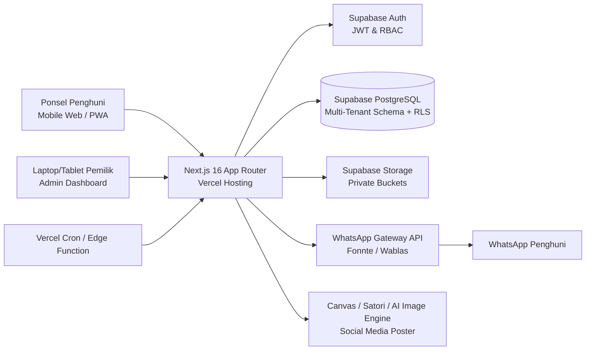

# Product Requirement Document (PRD)
## Atur kos
**Versi:** 1.0.0  
**Status:** Approved / Ready for Implementation  
**Target Rilis:** Q4 2026 (Fase Prototipe 8 Minggu)  
**Pemilik Produk:** Tim Pengembang Kos Princess  
**Arsitektur Target:** Next.js (App Router), Supabase (PostgreSQL, Auth, Storage), WhatsApp Gateway, Canvas/AI Poster Engine

---

## 1. Executive Summary & Problem Statement

### 1.1 Latar Belakang & Masalah Bisnis
Kos Princess adalah properti hunian sewa (kost) yang saat ini masih mengandalkan pencatatan manual dan komunikasi terfragmentasi melalui aplikasi pesan instan personal (WhatsApp). Pola operasional ini memicu tiga titik hambatan utama (*pain points*):
1. **Kebocoran Arus Kas & Keterlambatan Pembayaran:** Pemilik harus memeriksa mutasi rekening satu per satu dan menagih secara manual. Penagihan personal menimbulkan gesekan emosional dan sering terlewat, menyebabkan *Days Sales Outstanding* (DSO) tinggi.
2. **Keluhan Fasilitas Tercecer & Tidak Terlacak:** Laporan kerusakan fasilitas (air, listrik, WiFi, fasilitas bersama) tercampur dengan percakapan pribadi. Tidak ada SLA (*Service Level Agreement*), riwayat perbaikan, maupun transparansi status bagi penghuni.
3. **Tingkat Kekosongan Kamar (*Vacancy Lag*):** Pemberitahuan keluar mendadak (H-7 atau saat hari jatuh tempo) membuat kamar menganggur rata-rata 15–30 hari sebelum mendapatkan penghuni baru. Pembuatan materi pemasaran kamar kosong membutuhkan waktu dan biaya desain.

### 1.2 Solusi Produk
Aplikasi Web Internal Kos Princess menghadirkan sistem operasional terintegrasi:
* **Smart Billing & WhatsApp Reminder:** Penagihan terjadwal otomatis (H-3, Hari H, H+2) dengan mekanisme unggah bukti transfer dan verifikasi 1-klik oleh pemilik.
* **Helpdesk Kerusakan Fasilitas:** Pelaporan terstruktur (kamar pribadi & fasilitas umum) dilengkapi foto bukti dan pelacakan status transparan.
* **Mitigasi Kamar Kosong H-30 & Generator Poster Promosi AI:** Peringatan komitmen perpanjangan sewa 30 hari sebelum masa habis dan pembuatan aset poster pemasaran siap sebar secara instan.
* **Arsitektur Multi-Tenant Ready:** Skema basis data terisolasi menggunakan `kost_id` untuk kesiapan ekspansi multi-cabang di masa depan, meskipun saat ini beroperasi untuk entitas tunggal (*Kos Princess*).

---

## 2. Product Vision, Objectives & Success Metrics

### 2.1 Visi Produk
Menjadi platform manajemen hunian sewa mandiri yang menghilangkan friksi penagihan, menjamin transparansi kenyamanan fasilitas, dan meminimalkan waktu kamar menganggur melalui otomasi cerdas.

### 2.2 Tujuan Bisnis (*Business Objectives*)
* Mengurangi keterlambatan pembayaran sewa bulanan hingga $\ge 70\%$.
* Memangkas waktu respons penanganan komplain fasilitas di bawah 24 jam.
* Menurunkan durasi kamar kosong (*vacancy duration*) dari rata-rata 21 hari menjadi $\le 5$ hari.
* Mengeliminasi 100% pencatatan manual pembukuan kas masuk dari uang sewa.

### 2.3 Metrik Keberhasilan (*Success Metrics / KPIs*)

| Kategori | Metrik Kunci (KPI) | Baseline (Saat Ini) | Target (Setelah 2 Bulan) |
| :--- | :--- | :--- | :--- |
| **Financial / Revenue** | On-Time Rent Payment Rate | 45% tepat waktu | $\ge 85\%$ tepat waktu |
| **Financial / Revenue** | Average Days to Collect (DSO) | 8.5 hari setelah jatuh tempo | $\le 2$ hari setelah jatuh tempo |
| **Operational** | Complaint Resolution Turnaround (SLA) | 4-7 hari (sering lupa) | $< 48$ jam (status transparan) |
| **Operational** | Admin Hours on Billing & Chasing | ~12 jam/bulan | $< 1.5$ jam/bulan |
| **Occupancy** | Vacancy Period per Turnover | 21 hari menganggur | $\le 7$ hari menganggur |
| **Product Adoption** | Tenant Portal Active Engagement | 0% (semua via WA) | $\ge 90\%$ penghuni lapor & bayar via web |

---

## 3. User Personas & Jobs-To-Be-Done (JTBD)

### 3.1 Persona 1: Ibu Rina (Pemilik / Pengelola Kos Princess)
* **Karakteristik:** Wanita, 48 tahun, mengelola 20 kamar kos, aktif menggunakan smartphone, kurang menyukai software akuntansi rumit.
* **Tujuan Utama:**
  * Uang sewa masuk tepat waktu tanpa harus canggung menagih secara langsung.
  * Mengetahui kondisi fasilitas kamar dan keluhan anak kos tanpa harus mencatat di buku catatan.
  * Kamar yang akan ditinggalkan segera terisi kembali oleh penyewa baru.
* **Pain Points:**
  * Malu/lelah menagih berulang kali kepada penghuni yang menunggak.
  * Mutasi bank campur aduk antara uang pribadi dan sewa kamar.
  * Bingung membuat materi iklan/poster ketika ada kamar yang kosong.
* **JTBD Statement:**
  > *"Ketika tanggal jatuh tempo sewa tiba, saya ingin sistem otomatis mengingatkan penghuni dan menyajikan bukti transfer untuk saya verifikasi dengan satu klik, sehingga arus kas kos lancar tanpa friksi sosial."*

### 3.2 Persona 2: Dimas (Penghuni / Mahasiswa / Karyawan)
* **Karakteristik:** Pria/Wanita, 22 tahun, melek teknologi, serba digital, jadwal padat di kampus/kantor.
* **Tujuan Utama:**
  * Membayar uang kos dengan mudah, mendapat kuitansi/status sah, dan tidak ditagih mendadak.
  * Komplain fasilitas (misal: genteng bocor, WiFi mati) segera ditanggapi dan diperbaiki.
  * Privasi terjaga, informasi kos jelas dan terdokumentasi.
* **Pain Points:**
  * Sering lupa tanggal sewa karena tidak ada pengingat terjadwal.
  * Komplain via WA sering tenggelam dan tidak tahu kapan tukang akan datang.
  * Bingung memberi tahu pemilik saat ingin mengakhiri masa sewa.
* **JTBD Statement:**
  > *"Ketika ada kerusakan fasilitas di kamar saya, saya ingin melaporkannya lengkap dengan foto dan memantau progres perbaikannya secara real-time, agar kenyamanan belajar/bekerja saya tidak terganggu."*

---

## 4. User Flows & System Sequence

```mermaid
graph TD
    subgraph Onboarding & Alokasi
        A[Penghuni Register di Web] --> B[Input: Nama, WA, Password]
        B --> C[Status: Akun Terdaftar / Belum Ada Kamar]
        D[Pemilik Login ke Dasbor] --> E[Menu: Alokasi Kamar]
        E --> F[Pilih Kamar Kosong & Hubungkan Akun Penghuni]
        F --> G[Status Kamar -> Terisi & Tenant Aktif]
    end

    subgraph Siklus Tagihan & Smart Reminder
        H[Cron Harian Cek Jatuh Tempo] --> I{Status Tagihan?}
        I -->|H-3 Belum Lunas| J[Kirim WA Reminder 1: Tagihan Terbit]
        I -->|Hari H Belum Lunas| K[Kirim WA Reminder 2: Jatuh Tempo Hari Ini]
        I -->|H+2 Belum Lunas| L[Kirim WA Reminder 3: Tagihan Terlambat]
        I -->|Menunggu Verifikasi / Lunas| M[Abaikan / Skip Pengiriman]
        N[Penghuni Login & Upload Bukti Transfer] --> O[Status Tagihan: Menunggu Verifikasi]
        P[Pemilik Verifikasi Bukti Bayar] -->|Valid| Q[Status Tagihan: Lunas -> Otomatis Catat Kas Masuk]
        P -->|Tidak Valid| R[Tolak Bukti Bayar & Notifikasi Penghuni]
    end

    subgraph Penanganan Keluhan
        S[Penghuni Submit Tiket Keluhan] --> T[Pilih: Kamar Pribadi / Fasilitas Umum + Foto]
        T --> U[Status: Diajukan]
        V[Pemilik Review & Update: Sedang Dikerjakan] --> W[Tukang/Perbaikan Berjalan]
        W --> X[Pemilik Tandai: Selesai + Catatan]
        X --> Y[Penghuni Menerima Riwayat Selesai]
    end

    subgraph Mitigasi Kamar Kosong H-30
        Z[H-30 Sebelum Sewa Berakhir] --> AA[Formulir Komitmen Muncul di Dasbor Penghuni]
        AA -->|Pilih: Lanjut Sewa| AB[Generate Invoice Periode Berikutnya]
        AA -->|Pilih: Selesai Sewa| AC[Status Kamar: Akan Kosong per Tanggal X]
        AA -->|Tidak Merespons sampai H-20| AD[Status Kamar: Perlu Konfirmasi Manual di Dasbor Pemilik]
        AC --> AE[Pemilik Klik 'Buat Poster Promosi']
        AE --> AF[Sistem Generate Poster Promosi Siap Sebar WA/IG]
    end
```



---

## 5. Spesifikasi Fungsional Rinci (*Detailed Functional Requirements*)

### 5.1 Modul 1: Autentikasi, Profil & Manajemen Hak Akses (RBAC)

#### User Stories
* **US-1.1 (Penghuni):** Sebagai calon penghuni, saya ingin mendaftarkan akun secara mandiri dengan nomor WhatsApp aktif dan kata sandi agar saya memiliki akun di sistem.
* **US-1.2 (Pemilik):** Sebagai pemilik, saya ingin masuk (*login*) dengan kredensial terverifikasi untuk mengakses dasbor administratif.
* **US-1.3 (Sistem):** Sebagai sistem, saya harus memvalidasi peran pengguna (*Role-Based Access Control*: `owner` vs `tenant`) dan mengisolasi data sesuai `kost_id`.

#### Spesifikasi Fungsional & Aturan Bisnis
1. **Registrasi:** Field wajib meliputi `nama_lengkap`, `nomor_wa` (format E.164: `628xxx`), `email` (opsional/identitas login), dan `password` (min. 8 karakter).
2. **Kondisi Akun Baru:** Penghuni yang baru mendaftar memiliki status `unallocated` (belum terikat kamar). Dasbor penghuni menampilkan status *"Menunggu alokasi kamar oleh pemilik"*.
3. **Pemisahan Hak Akses:**
   * `owner`: Mengelola seluruh kamar, penghuni, tagihan, pembukuan kas, dan tiket keluhan.
   * `tenant`: Hanya dapat melihat kamar miliknya, tagihan miliknya, tiket keluhan yang dibuatnya, dan keluhan fasilitas umum kos.

#### Kriteria Penerimaan (Acceptance Criteria)
```gherkin
Scenario: Registrasi penghuni baru berhasil
  Given Calon penghuni berada di halaman registrasi
  When Mengisi nama "Budi Santoso", nomor WA "081234567890", dan password valid
  Then Sistem mengonversi nomor WA menjadi format "6281234567890"
  And Membuat record user dengan role "tenant"
  And Menampilkan halaman selamat datang dengan pesan status menunggu alokasi kamar

Scenario: Proteksi rute berdasarkan role
  Given Pengguna login dengan role "tenant"
  When Mencoba mengakses rute "/dashboard/admin" atau API pembukuan kas
  Then Sistem memblokir akses dan mengembalikan respons 403 Forbidden atau redirect ke "/dashboard/tenant"
```

---

### 5.2 Modul 2: Manajemen Kamar & Penghuni (*Room & Tenant Management*)

#### User Stories
* **US-2.1 (Pemilik):** Sebagai pemilik, saya ingin menambah, mengubah, dan melihat daftar kamar kos beserta statusnya (Kosong, Terisi, Akan Kosong, Perbaikan).
* **US-2.2 (Pemilik):** Sebagai pemilik, saya ingin mengalokasikan akun penghuni terdaftar ke nomor kamar tertentu lengkap dengan tanggal mulai sewa dan nominal harga sewa disepakati.
* **US-2.3 (Pemilik):** Sebagai pemilik, saya ingin melakukan *check-out* penghuni ketika masa sewa berakhir agar kamar kembali kosong.

#### Spesifikasi Fungsional & Aturan Bisnis
1. **Data Master Kamar:**
   * Atribut: `nomor_kamar`, `tipe_kamar` (Standard, Deluxe, VIP), `harga_bulanan`, `fasilitas_list` (array: AC, Kamar Mandi Dalam, Kasur, Lemari, dll), `foto_kamar` (URL file storage).
   * Status Kamar:
     * `kosong`: Kamar siap huni.
     * `terisi`: Dihuni oleh penyewa aktif.
     * `akan_kosong`: Dihuni, namun penghuni telah konfirmasi tidak memperpanjang sewa.
     * `perbaikan`: Dalam renovasi/perbaikan fasilitas.
2. **Alokasi Kamar:**
   * Satu kamar hanya dapat dialokasikan ke satu penyewa aktif pada rentang waktu yang sama (*1 room to 1 active tenant relationship*).
   * Saat alokasi dilakukan, sistem membuat entitas `tenants` yang menghubungkan `user_id`, `room_id`, `tanggal_masuk`, `siklus_tagihan` (tanggal jatuh tempo bulanan).

#### Kriteria Penerimaan (Acceptance Criteria)
```gherkin
Scenario: Alokasi kamar ke penghuni
  Given Kamar "Kamar 05" berstatus "kosong"
  And Penghuni "Budi Santoso" belum memiliki kamar aktif
  When Pemilik memilih "Kamar 05", memilih penghuni "Budi Santoso", tanggal masuk "2026-10-01", jatuh tempo tiap tanggal 1
  Then Status "Kamar 05" berubah menjadi "terisi"
  And Data penyewa aktif terbentuk dan terhubung ke profil Budi Santoso
```

---

### 5.3 Modul 3: Keuangan, Smart Billing & WhatsApp Reminder Engine

#### User Stories
* **US-3.1 (Sistem):** Sebagai sistem, saya ingin menerbitkan tagihan sewa bulanan secara otomatis sesuai tanggal siklus jatuh tempo masing-masing penghuni.
* **US-3.2 (Penghuni):** Sebagai penghuni, saya ingin melihat rincian tagihan, nomor rekening pembayaran pemilik, dan mengunggah foto bukti transfer bank.
* **US-3.3 (Pemilik):** Sebagai pemilik, saya ingin meninjau bukti transfer yang diunggah dan memverifikasinya menjadi `Lunas` atau menolaknya jika nominal/rekening tidak sesuai.
* **US-3.4 (Sistem):** Sebagai sistem, saya ingin mengirimkan pesan pengingat jatuh tempo via WhatsApp Gateway pada H-3, Hari H, dan H+2 kepada penghuni yang belum lunas.

#### Spesifikasi Fungsional & Aturan Bisnis
1. **Siklus Penerbitan Tagihan:**
   * Tagihan baru diterbitkan otomatis pada H-7 sebelum tanggal jatuh tempo penghuni.
   * Nomor tagihan unik berformat: `INV/YYYYMM/[NOMOR_KAMAR]/[ID]`.
   * Status Tagihan: `belum_bayar` $\rightarrow$ `menunggu_verifikasi` $\rightarrow$ `lunas` (atau `ditolak`).
2. **Unggah Bukti Bayar:**
   * Format file: JPG, PNG, WEBP (maks. 5MB).
   * File disimpan di Supabase Storage bucket privat (`payment-proofs`) dengan URL bertanda tangan (*signed URL*).
3. **Otomasi WhatsApp Reminder (Cron Engine):**
   * Cron Job dieksekusi setiap hari pada pukul **09:00 WIB**.
   * Sistem memindai tabel `invoices` yang berstatus `belum_bayar`:
     * **Trigger H-3:** Jatuh tempo dalam 3 hari $\rightarrow$ Kirim Template A (Pemberitahuan Tagihan Terbit).
     * **Trigger Hari H:** Jatuh tempo hari ini $\rightarrow$ Kirim Template B (Hari Ini Jatuh Tempo).
     * **Trigger H+2:** Jatuh tempo terlewat 2 hari $\rightarrow$ Kirim Template C (Pemberitahuan Tunggakan).
   * **Aturan Pembatalan Otomatis (*Idempotency & Skip*):**
     * Jika invoice berstatus `menunggu_verifikasi` atau `lunas`, pengiriman WhatsApp WAJIB dibatalkan/dilewati (*skip*).
     * Setiap pesan yang terkirim dicatat pada log pesan untuk mencegah pengiriman ganda pada hari yang sama.

#### Template Notifikasi WhatsApp
* **Template H-3:**
  > *"Halo {nama_penghuni}, tagihan sewa Kos Princess kamar {nomor_kamar} untuk periode {periode} sebesar Rp {nominal} akan jatuh tempo pada {tanggal_jatuh_tempo}. Pembayaran dapat ditransfer ke Rek. BCA 1234567890 a.n Kos Princess. Silakan unggah bukti bayar di tautan: {link_portal}. Terima kasih!"*
* **Template Hari H:**
  > *"Halo {nama_penghuni}, hari ini adalah batas akhir pembayaran sewa kamar {nomor_kamar}. Mohon segera melakukan transfer dan mengunggah bukti bayar melalui {link_portal}. Abaikan pesan ini jika Anda sudah mengunggahnya."*
* **Template H+2:**
  > *"Halo {nama_penghuni}, catatan kami menunjukkan tagihan sewa kamar {nomor_kamar} telah melewati tanggal jatuh tempo ({tanggal_jatuh_tempo}). Mohon konfirmasi atau segera selesaikan pembayaran untuk menghindari denda/gangguan kenyamanan fasilitas."*

#### Kriteria Penerimaan (Acceptance Criteria)
```gherkin
Scenario: Pengiriman reminder otomatis dibatalkan jika bukti sudah diunggah
  Given Tagihan kamar 02 jatuh tempo hari ini (Hari H)
  And Penghuni telah mengunggah bukti bayar pada pukul 08:00 WIB
  And Status tagihan adalah "menunggu_verifikasi"
  When Cron job WhatsApp reminder berjalan pada pukul 09:00 WIB
  Then Sistem mendeteksi status bukan "belum_bayar"
  And Sistem TIDAK mengirimkan pesan WhatsApp ke penghuni kamar 02
```

---

### 5.4 Modul 4: Helpdesk & Tiket Keluhan Kerusakan Fasilitas

#### User Stories
* **US-4.1 (Penghuni):** Sebagai penghuni, saya ingin membuat tiket keluhan kerusakan fasilitas (kamar pribadi atau fasilitas bersama) dengan melampirkan foto bukti agar segera diperbaiki.
* **US-4.2 (Penghuni):** Sebagai penghuni, saya ingin memantau perubahan status penanganan komplain saya secara transparan di dasbor.
* **US-4.3 (Pemilik):** Sebagai pemilik, saya ingin melihat daftar tiket aktif, memperbarui status pengerjaan, dan menambahkan catatan progres/jadwal kedatangan tukang.

#### Spesifikasi Fungsional & Aturan Bisnis
1. **Cakupan Masalah:**
   * `kamar_pribadi`: Keluhan hanya terlihat oleh pelapor dan pemilik.
   * `fasilitas_umum`: Keluhan terlihat oleh seluruh penghuni kos agar tidak terjadi pelaporan berulang untuk masalah yang sama (contoh: pompa air mati, lampu lorong putus, kompor dapur umum rusak).
2. **Siklus Hidup Status Tiket:**
   * `diajukan`: Tiket baru dibuat oleh penghuni.
   * `sedang_dikerjakan`: Pemilik telah menugaskan teknisi/dalam proses perbaikan.
   * `selesai`: Fasilitas telah diperbaiki dan diverifikasi oleh pemilik.
3. **Lampiran Foto:**
   * Wajib melampirkan minimal 1 foto bukti kerusakan (maksimal 3 foto, @5MB).

#### Kriteria Penerimaan (Acceptance Criteria)
```gherkin
Scenario: Penghuni melaporkan kerusakan fasilitas umum
  Given Penghuni berada di menu "Lapor Keluhan"
  When Memilih cakupan "Fasilitas Umum", kategori "Pompa Air", deskripsi "Air mati sejak jam 6 pagi", dan upload 1 foto kran kering
  Then Tiket keluhan tersimpan dengan status "diajukan"
  And Tiket muncul pada daftar keluhan publik kos sehingga penghuni lain dapat melihat statusnya
  And Notifikasi muncul di dasbor pemilik
```

---

### 5.5 Modul 5: Mitigasi Kamar Kosong H-30 & AI Marketing Poster Generator

#### User Stories
* **US-5.1 (Sistem & Penghuni):** Sebagai penghuni yang masa sewanya tersisa 30 hari, saya ingin menerima formulir konfirmasi sederhana untuk menyatakan apakah saya akan melanjutkan sewa atau selesai sewa.
* **US-5.2 (Pemilik):** Sebagai pemilik, saya ingin mengetahui status kamar yang akan kosong sebulan sebelum penyewa keluar, sehingga saya bisa segera memasarkannya.
* **US-5.3 (Pemilik):** Sebagai pemilik, saya ingin membuat poster pemasaran promosi kamar secara otomatis dengan 1 klik saat status kamar `akan_kosong` atau `kosong`.

#### Spesifikasi Fungsional & Aturan Bisnis
1. **Mekanisme Peringatan H-30:**
   * Sistem mendeteksi penghuni yang masa sewa periodiknya tersisa 30 hari.
   * Dasbor penghuni menampilkan modal konfirmasi komitmen perpanjangan:
     * **Pilihan A: "Lanjut Sewa"** $\rightarrow$ Status sewa diperpanjang; jadwal invoice periode berikutnya dibuat.
     * **Pilihan B: "Selesai Sewa"** $\rightarrow$ Penghuni diminta konfirmasi tanggal keluar (*check-out date*); status kamar otomatis menjadi `akan_kosong`.
2. **Penanganan Tanpa Respons (*Fallback Mechanism*):**
   * Jika penghuni tidak memilih hingga batas H-20 (10 hari setelah formulir muncul), sistem tidak akan melakukan spam pop-up.
   * Sistem otomatis menandai kamar tersebut di dasbor pemilik sebagai: `perlu_konfirmasi_manual` agar pemilik dapat menanyakan langsung saat berinteraksi santai.
3. **AI / Automated Marketing Poster Generator:**
   * Tombol *"Buat Poster Promosi"* aktif pada kamar berstatus `akan_kosong` atau `kosong`.
   * **Mesin Pembuat Grafis:** Menggunakan template grafis berbasis Canvas/SVG/Satori yang di-render ke format PNG (aspek rasio 1:1 untuk feed Instagram dan 9:16 untuk WhatsApp Story / Instagram Story).
   * **Konten Poster Otomatis:**
     * Judul: *"Kamar Kos Siap Huni - Kos Princess"*
     * Foto Utama Kamar (diambil dari data master kamar).
     * Rincian Fasilitas (ikon: AC, WiFi, Kamar Mandi Dalam, Kasur Springbed).
     * Harga Sewa Bulanan.
     * Ketersediaan: *"Tersedia per [Tanggal Kosong]"*.
     * Call-to-Action (CTA): Nomor WhatsApp Pemilik & Alamat Singkat.
     * Copywriting teks caption promosi yang di-generate otomatis untuk siap di-*copy-paste* ke media sosial.

#### Kriteria Penerimaan (Acceptance Criteria)
```gherkin
Scenario: Pemilik menghasilkan poster pemasaran kamar kosong
  Given Kamar 08 berstatus "akan_kosong" per tanggal "2026-11-01"
  When Pemilik menekan tombol "Buat Poster Promosi"
  Then Sistem menghasilkan gambar poster beresolusi tinggi (format 1:1 dan 9:16) memuat foto kamar, harga, fasilitas, dan kontak pemilik
  And Menyediakan tombol "Unduh Poster" dan "Salin Teks Promosi"
```

---

### 5.6 Modul 6: Pembukuan Kas Masuk & Keluar Sederhana

#### User Stories
* **US-6.1 (Sistem):** Sebagai sistem, saya ingin otomatis mencatat kas masuk setiap kali pemilik memverifikasi pembayaran sewa menjadi `Lunas`.
* **US-6.2 (Pemilik):** Sebagai pemilik, saya ingin mencatat pengeluaran operasional (seperti bayar listrik, teknisi perbaikan, sampah, internet) secara manual.
* **US-6.3 (Pemilik):** Sebagai pemilik, saya ingin melihat ringkasan arus kas bulanan (Total Pemasukan, Total Pengeluaran, Saldo Bersih).

#### Spesifikasi Fungsional & Aturan Bisnis
1. **Otomasi Kas Masuk:**
   * Saat invoice diubah menjadi `lunas`, sistem otomatis melakukan *insert* ke tabel `cash_ledgers` dengan `kategori = 'sewa_kamar'`, `tipe = 'masuk'`, referensi `invoice_id`.
2. **Pencatatan Kas Keluar:**
   * Pemilik menginput: `tanggal`, `kategori` (listrik_air, internet_wifi, perbaikan_fasilitas, kebersihan, operasional_lain), `nominal`, `keterangan`, dan opsional `bukti_nota`.
3. **Laporan:**
   * Kartu ringkasan di dasbor: Pemasukan Bulan Ini, Pengeluaran Bulan Ini, Laba Operasional Bersih (*Net Operating Income*).

---

### 5.7 Modul 7: Papan Pengumuman Digital, Manajemen Paket & Lost-and-Found

#### User Stories
* **US-7.1 (Pemilik):** Sebagai pemilik, saya ingin membuat pengumuman dengan foto (paket kurir tiba, barang tercecer/hilang, info fasilitas) dan memilih target (kamar spesifik atau seluruh kos).
* **US-7.2 (Penghuni):** Sebagai penghuni, saya ingin menerima notifikasi instan di HP (*Push Notification*) saat ada paket untuk kamar saya tiba atau ada pengumuman darurat kos.
* **US-7.3 (Penghuni & Pemilik):** Sebagai penghuni/pemilik, saya ingin menandai paket atau barang hilang sebagai *"Sudah Diambil / Selesai"* agar papan pengumuman tetap rapi dan mutakhir.

#### Spesifikasi Fungsional & Aturan Bisnis
1. **Kategori Pengumuman:**
   * `paket`: Paket/dokumen kurir tiba di teras atau lobi kos.
   * `barang_hilang`: Ditemukan barang tercecer di area bersama (helm, kunci motor, pakaian jemuran tertukar).
   * `info_operasional`: Pemberitahuan darurat/penting operasional kos (jadwal kuras toren air, listrik padam, aturan ketertiban).
   * `umum`: Informasi umum komunitas kos.
2. **Target Audiens & Pengiriman Push Notification:**
   * **Target Kamar Tertentu (`target_room_id`):** Digunakan saat paket jelas pemiliknya (misal: paket untuk Kamar 05). Push notification HP hanya dikirimkan ke perangkat penghuni kamar tersebut untuk mencegah gangguan (*notification fatigue*) bagi penghuni lain.
   * **Target Seluruh Kos (`target_room_id IS NULL`):** Digunakan untuk info darurat air/listrik atau barang tercecer tak bertuan. Notifikasi disiarkan (*broadcast*) ke seluruh penghuni aktif.
3. **Penyelesaian Status (*Resolved State*):**
   * Setiap postingan memiliki atribut `is_resolved`.
   * Penghuni penerima paket atau pemilik dapat menekan *"Tandai Sudah Diambil"* yang mengubah status menjadi `is_resolved = TRUE`, memindahkan kartu dari banner aktif ke daftar arsip/riwayat.

#### Kriteria Penerimaan (Acceptance Criteria)
```gherkin
Scenario: Notifikasi paket tiba untuk kamar tertentu
  Given Pemilik memfoto paket kurir berlabel "Kamar 05"
  When Pemilik memilih kategori "Paket", memilih target "Kamar 05", judul "Paket Kurir Tiba di Lobi"
  And Menekan tombol "Terbitkan Pengumuman"
  Then Sistem menyimpan data ke tabel announcements
  And Sistem mengirimkan push notification HP (FCM) HANYA ke perangkat penghuni Kamar 05
  And Pengumuman muncul sebagai banner aktif di beranda aplikasi penghuni Kamar 05

Scenario: Penghuni menandai paket telah diambil
  Given Pengumuman paket kamar 05 masih aktif
  When Penghuni kamar 05 mengambil paket dan menekan tombol "Sudah Diambil"
  Then Atribut is_resolved berubah menjadi TRUE
  And Banner aktif di beranda otomatis disembunyikan dan dipindahkan ke arsip
```

---

## 6. Non-Functional Requirements (NFRs)

### 6.1 Keamanan & Privasi Data (*Security & Privacy*)
* **Autentikasi & Otorisasi:** Menggunakan Supabase Auth (JWT) dengan enkripsi bcrypt/argon2 untuk kredensial.
* **Row Level Security (RLS):** Seluruh tabel PostgreSQL wajib mengaktifkan PostgreSQL RLS:
  * Tenant hanya dapat melakukan `SELECT` pada data milik `user_id` atau `kost_id` bersangkutan.
  * Tenant dilarang mengubah status `invoices` atau mengakses `cash_ledgers`.
* **Proteksi Berkas Bukti Bayar:** Bukti transfer disimpan dalam *private bucket* Supabase Storage. Akses unduh/tinjau menggunakan *time-limited signed URL* (berlaku maks. 60 menit) khusus untuk pemilik dan penghuni pemilik invoice.
* **Input Sanitization & CSRF:** Proteksi terhadap XSS, validasi schema request menggunakan Zod di server actions/API routes Next.js.

### 6.2 Performa & Skalabilitas (*Performance & Scalability*)
* **Waktu Muat Halaman:** Largest Contentful Paint (LCP) $\le 1.8$ detik pada jaringan 4G mobile.
* **Kompresi Gambar:** Semua unggahan foto (bukti bayar, keluhan) dikompresi otomatis di sisi klien sebelum dikirim ke server (maks. dimensi 1280px, kualitas 80%, ukuran rata-rata $< 500$ KB).
* **Multi-Tenant Ready:** Skema dirancang dengan menyertakan indeks `kost_id` pada setiap tabel relasional untuk memudahkan isolasi query ketika di masa depan melayani banyak properti kos.

### 6.3 Keandalan (*Reliability & Resilience*)
* **Ketersediaan Sistem:** Target ketersediaan layanan $\ge 99.5\%$ (berbasis arsitektur serverless Vercel & Supabase).
* **WhatsApp Gateway Fail-Safe:**
  * Penanganan *rate limiting* (maksimal 1 pesan per 3 detik untuk mencegah nomor WhatsApp terblokir/banned).
  * Mekanisme *retry* maksimal 2 kali jika gateway mengembalikan status error jaringan, disertai *logging* status pengiriman (`pending`, `sent`, `failed`).

### 6.4 Aksesibilitas & Tampilan Antarmuka (*Usability & Mobile-First*)
* **Mobile-First untuk Penghuni:** Antarmuka penghuni dioptimalkan untuk layar ponsel pintar (360px – 430px viewport) menyerupai Progressive Web App (PWA).
* **Desktop/Tablet untuk Pemilik:** Dasbor pemilik dirancang responsif dan nyaman digunakan di laptop maupun tablet untuk mempermudah audit data dan pembukuan.

---

## 7. Arsitektur Sistem & Spesifikasi Basis Data

### 7.1 Diagram Arsitektur Teknologi



### 7.2 Spesifikasi Skema Basis Data (Multi-Tenant Ready)

#### 1. Tabel `kosts`
Menyimpan identitas properti kos.
```sql
CREATE TABLE kosts (
    id UUID PRIMARY KEY DEFAULT gen_random_uuid(),
    nama_kost VARCHAR(100) NOT NULL DEFAULT 'Kos Princess',
    alamat TEXT NOT NULL,
    nomor_kontak VARCHAR(20) NOT NULL,
    rekening_bank VARCHAR(50),
    nama_pemilik_rekening VARCHAR(100),
    created_at TIMESTAMPTZ DEFAULT NOW(),
    updated_at TIMESTAMPTZ DEFAULT NOW()
);
```

#### 2. Tabel `users`
Menyimpan profil pengguna yang terhubung ke Supabase Auth (`auth.users`).
```sql
CREATE TYPE user_role AS ENUM ('owner', 'tenant');

CREATE TABLE users (
    id UUID PRIMARY KEY REFERENCES auth.users(id) ON DELETE CASCADE,
    kost_id UUID REFERENCES kosts(id) ON DELETE RESTRICT,
    nama VARCHAR(100) NOT NULL,
    nomor_wa VARCHAR(20) NOT NULL UNIQUE,
    role user_role NOT NULL DEFAULT 'tenant',
    fcm_token TEXT,
    created_at TIMESTAMPTZ DEFAULT NOW(),
    updated_at TIMESTAMPTZ DEFAULT NOW()
);
CREATE INDEX idx_users_kost_id ON users(kost_id);
```

#### 3. Tabel `rooms`
Menyimpan inventaris kamar dan fasilitas.
```sql
CREATE TYPE room_status AS ENUM ('kosong', 'terisi', 'akan_kosong', 'perbaikan');

CREATE TABLE rooms (
    id UUID PRIMARY KEY DEFAULT gen_random_uuid(),
    kost_id UUID NOT NULL REFERENCES kosts(id) ON DELETE CASCADE,
    nomor_kamar VARCHAR(20) NOT NULL,
    tipe VARCHAR(50) NOT NULL DEFAULT 'Standard',
    harga_bulanan NUMERIC(12, 2) NOT NULL,
    fasilitas TEXT[] DEFAULT '{}',
    foto_url TEXT,
    status room_status NOT NULL DEFAULT 'kosong',
    created_at TIMESTAMPTZ DEFAULT NOW(),
    updated_at TIMESTAMPTZ DEFAULT NOW(),
    CONSTRAINT unique_room_per_kost UNIQUE (kost_id, nomor_kamar)
);
CREATE INDEX idx_rooms_kost_status ON rooms(kost_id, status);
```

#### 4. Tabel `tenants`
Relasi alokasi sewa aktif antara penghuni dan kamar.
```sql
CREATE TYPE tenant_status AS ENUM ('aktif', 'akan_berakhir', 'keluar');

CREATE TABLE tenants (
    id UUID PRIMARY KEY DEFAULT gen_random_uuid(),
    kost_id UUID NOT NULL REFERENCES kosts(id) ON DELETE CASCADE,
    user_id UUID NOT NULL REFERENCES users(id) ON DELETE CASCADE,
    room_id UUID NOT NULL REFERENCES rooms(id) ON DELETE RESTRICT,
    tanggal_masuk DATE NOT NULL,
    tanggal_jatuh_tempo_bulanan INT NOT NULL CHECK (tanggal_jatuh_tempo_bulanan BETWEEN 1 AND 31),
    tanggal_akhir_sewa DATE,
    status_sewa tenant_status NOT NULL DEFAULT 'aktif',
    h30_response VARCHAR(30) DEFAULT 'menunggu', -- 'lanjut', 'selesai', 'menunggu', 'perlu_manual'
    created_at TIMESTAMPTZ DEFAULT NOW(),
    updated_at TIMESTAMPTZ DEFAULT NOW()
);
CREATE INDEX idx_tenants_active ON tenants(kost_id, status_sewa);
```

#### 5. Tabel `invoices`
Pencatatan tagihan dan verifikasi pembayaran sewa.
```sql
CREATE TYPE invoice_status AS ENUM ('belum_bayar', 'menunggu_verifikasi', 'lunas', 'ditolak');

CREATE TABLE invoices (
    id UUID PRIMARY KEY DEFAULT gen_random_uuid(),
    kost_id UUID NOT NULL REFERENCES kosts(id) ON DELETE CASCADE,
    tenant_id UUID NOT NULL REFERENCES tenants(id) ON DELETE RESTRICT,
    nomor_invoice VARCHAR(50) NOT NULL UNIQUE,
    periode VARCHAR(20) NOT NULL, -- Contoh: '2026-10'
    nominal NUMERIC(12, 2) NOT NULL,
    tanggal_jatuh_tempo DATE NOT NULL,
    bukti_bayar_url TEXT,
    tanggal_bayar TIMESTAMPTZ,
    diverifikasi_pada TIMESTAMPTZ,
    status invoice_status NOT NULL DEFAULT 'belum_bayar',
    catatan_penolakan TEXT,
    created_at TIMESTAMPTZ DEFAULT NOW(),
    updated_at TIMESTAMPTZ DEFAULT NOW()
);
CREATE INDEX idx_invoices_status_date ON invoices(kost_id, status, tanggal_jatuh_tempo);
```

#### 6. Tabel `notification_logs`
Mencegah spam dan duplikasi pengiriman pesan WhatsApp.
```sql
CREATE TABLE notification_logs (
    id UUID PRIMARY KEY DEFAULT gen_random_uuid(),
    invoice_id UUID NOT NULL REFERENCES invoices(id) ON DELETE CASCADE,
    tipe_reminder VARCHAR(20) NOT NULL, -- 'H-3', 'Hari-H', 'H+2'
    nomor_tujuan VARCHAR(20) NOT NULL,
    status_kirim VARCHAR(20) NOT NULL, -- 'sent', 'failed'
    response_payload JSONB,
    sent_at TIMESTAMPTZ DEFAULT NOW()
);
CREATE UNIQUE INDEX uq_invoice_reminder ON notification_logs(invoice_id, tipe_reminder);
```

#### 7. Tabel `complaints`
Sistem tiket keluhan dan pelacakan perbaikan fasilitas.
```sql
CREATE TYPE complaint_scope AS ENUM ('kamar_pribadi', 'fasilitas_umum');
CREATE TYPE complaint_status AS ENUM ('diajukan', 'sedang_dikerjakan', 'selesai');

CREATE TABLE complaints (
    id UUID PRIMARY KEY DEFAULT gen_random_uuid(),
    kost_id UUID NOT NULL REFERENCES kosts(id) ON DELETE CASCADE,
    tenant_id UUID NOT NULL REFERENCES tenants(id) ON DELETE CASCADE,
    tipe_fasilitas complaint_scope NOT NULL DEFAULT 'kamar_pribadi',
    judul VARCHAR(150) NOT NULL,
    deskripsi TEXT NOT NULL,
    foto_urls TEXT[] DEFAULT '{}',
    status complaint_status NOT NULL DEFAULT 'diajukan',
    catatan_penanganan TEXT,
    diselesaikan_pada TIMESTAMPTZ,
    created_at TIMESTAMPTZ DEFAULT NOW(),
    updated_at TIMESTAMPTZ DEFAULT NOW()
);
CREATE INDEX idx_complaints_kost_status ON complaints(kost_id, status);
```

#### 8. Tabel `cash_ledgers`
Pencatatan pembukuan kas masuk dan kas keluar.
```sql
CREATE TYPE cash_flow_type AS ENUM ('masuk', 'keluar');

CREATE TABLE cash_ledgers (
    id UUID PRIMARY KEY DEFAULT gen_random_uuid(),
    kost_id UUID NOT NULL REFERENCES kosts(id) ON DELETE CASCADE,
    tipe cash_flow_type NOT NULL,
    kategori VARCHAR(50) NOT NULL, -- 'sewa_kamar', 'listrik_air', 'wifi', 'perbaikan', 'lainnya'
    nominal NUMERIC(12, 2) NOT NULL,
    tanggal DATE NOT NULL DEFAULT CURRENT_DATE,
    keterangan TEXT,
    invoice_id UUID REFERENCES invoices(id) ON DELETE SET NULL,
    bukti_nota_url TEXT,
    created_at TIMESTAMPTZ DEFAULT NOW()
);
CREATE INDEX idx_cash_ledgers_date ON cash_ledgers(kost_id, tanggal);
```

#### 9. Tabel `announcements`
Papan pengumuman, paket kurir tiba, dan pelacakan barang tercecer / lost-and-found.
```sql
CREATE TYPE announcement_category AS ENUM ('paket', 'barang_hilang', 'info_operasional', 'umum');

CREATE TABLE announcements (
    id UUID PRIMARY KEY DEFAULT gen_random_uuid(),
    kost_id UUID NOT NULL REFERENCES kosts(id) ON DELETE CASCADE,
    author_id UUID NOT NULL REFERENCES users(id) ON DELETE CASCADE,
    target_room_id UUID REFERENCES rooms(id) ON DELETE SET NULL, -- NULL = disiarkan ke seluruh penghuni kos
    kategori announcement_category NOT NULL DEFAULT 'paket',
    judul VARCHAR(150) NOT NULL,
    deskripsi TEXT NOT NULL,
    foto_urls TEXT[] DEFAULT '{}',
    is_pinned BOOLEAN DEFAULT FALSE,
    is_resolved BOOLEAN DEFAULT FALSE, -- Ditandai TRUE jika paket/barang telah diambil
    created_at TIMESTAMPTZ DEFAULT NOW(),
    updated_at TIMESTAMPTZ DEFAULT NOW()
);
CREATE INDEX idx_announcements_kost ON announcements(kost_id, is_pinned DESC, created_at DESC);
CREATE INDEX idx_announcements_target_room ON announcements(target_room_id);
```

---

## 8. Integrasi Pihak Ketiga (*Third-Party Integrations*)

| Komponen | Provider / Solusi | Fungsi & Peran |
| :--- | :--- | :--- |
| **Database & Auth** | Supabase (PostgreSQL 15+) | Autentikasi JWT, database relasional, Row-Level Security |
| **Object Storage** | Supabase Storage | Penyimpanan gambar bukti bayar (privat) & foto kamar/keluhan/paket (publik terkelola) |
| **Push Notification** | Firebase Cloud Messaging (FCM) | Notifikasi instan ke HP penghuni untuk paket kurir, barang tercecer, dan info darurat kos |
| **WhatsApp Gateway** | Fonnte / Wablas REST API | Pengiriman notifikasi pengingat pembayaran otomatis via API |
| **Cron Scheduler** | Vercel Cron / Supabase pg_cron | Pemicu harian pukul 09:00 WIB untuk memeriksa jatuh tempo |
| **Poster Engine** | `@vercel/og` / Satori / Canvas API / Flutter RepaintBoundary | Merender grafik poster promosi kamar siap unduh & sebar |

---

## 9. Manajemen Risiko & Mitigasi (*Risks & Mitigations*)

| Risiko | Tingkat Keparahan | Probabilitas | Rencana Mitigasi |
| :--- | :--- | :--- | :--- |
| **Pemblokiran Nomor WhatsApp akibat Spam** | Tinggi | Sedang | Terapkan jeda antrean (throttle) minimal 3 detik antar pesan, batasi reminder maksimal 3 kali per siklus sewa, gunakan penyedia API berizin/terpercaya. |
| **Pemilik Lambat Memverifikasi Bukti Bayar** | Sedang | Tinggi | Sistem menampilkan *badge counter* jumlah bukti yang menunggu verifikasi di bilah navigasi atas dasbor pemilik. |
| **Penghuni Mengunggah Bukti Palsu / Tidak Jelas** | Sedang | Sedang | Pemilik memiliki tombol "Tolak Bukti" dengan input alasan wajib yang otomatis memicu notifikasi pembaruan ke penghuni. |
| **Biaya Penyimpanan File Membengkak** | Rendah | Sedang | Wajibkan kompresi gambar di sisi klien sebelum upload (maksimal 500 KB per gambar). Terapkan batas retensi 1 tahun untuk arsip bukti transfer lama. |
| **Penghuni Mengabaikan Formulir H-30** | Sedang | Tinggi | Mekanisme *fallback*: sistem mengubah status kamar menjadi `Perlu Konfirmasi Manual` agar pemilik dapat bertanya langsung tanpa membebani penghuni dengan formulir berulang. |

---

## 10. Rencana Rilis & Milestones (Roadmap 8 Minggu)

### Minggu 1–2: Sprint 1 (Fondasi & Manajemen Kamar)
* Inisialisasi arsitektur Supabase (tabel `kosts`, `users`, `rooms`, `tenants`) & konfigurasi RLS.
* Autentikasi Pengguna (Login/Register penghuni & login pemilik).
* CRUD Master Kamar & antarmuka alokasi kamar di dasbor pemilik.

### Minggu 3–4: Sprint 2 (Smart Billing & Verifikasi Pembayaran)
* Logika penerbitan invoice bulanan otomatis.
* Halaman tagihan penghuni & mekanisme unggah bukti transfer ke private storage.
* Halaman verifikasi pembayaran oleh pemilik (Validasi / Tolak).
* Otomasi pencatatan ke tabel `cash_ledgers` saat status menjadi `lunas`.

### Minggu 5: Sprint 3 (WhatsApp Gateway & Reminder Engine)
* Integrasi API WhatsApp Gateway (Fonnte/Wablas).
* Pembuatan skrip Cron Job harian (H-3, Hari H, H+2) dengan validasi idempotensi & tabel log pengiriman.
* Pengujian pengiriman pesan langsung ke nomor pengujian.

### Minggu 6: Sprint 4 (Helpdesk Kerusakan Fasilitas & Papan Pengumuman Paket)
* Antarmuka pengajuan keluhan penghuni (kamar pribadi & fasilitas umum) dengan multi-upload foto.
* Dasbor penanganan keluhan bagi pemilik (pembaruan status & catatan perbaikan).
* Feed keluhan fasilitas umum pada dasbor penghuni.
* Modul Papan Pengumuman Digital (Paket kurir tiba & Lost-and-Found) dengan integrasi Push Notification HP (FCM).

### Minggu 7: Sprint 5 (Mitigasi Kamar Kosong H-30 & AI Poster Generator)
* Logika deteksi H-30 dan modal formulir komitmen penghuni.
* Logika penanganan status kamar (`akan_kosong` dan `perlu_konfirmasi_manual`).
* Pengembangan generator poster pemasaran kamar kosong (render foto, rincian fasilitas, harga, nomor kontak) format 1:1 dan 9:16.

### Minggu 8: Sprint 6 (UAT, Hardening, & Deployment)
* UAT (*User Acceptance Testing*) bersama pemilik Kos Princess dan perwakilan penghuni.
* Audit keamanan (validasi RLS, proteksi URL file, sanitasi input).
* Peluncuran prototipe ke lingkungan *production* (Vercel).
