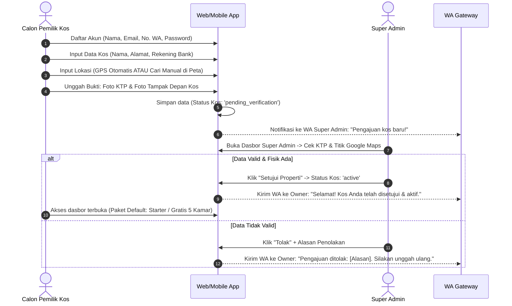
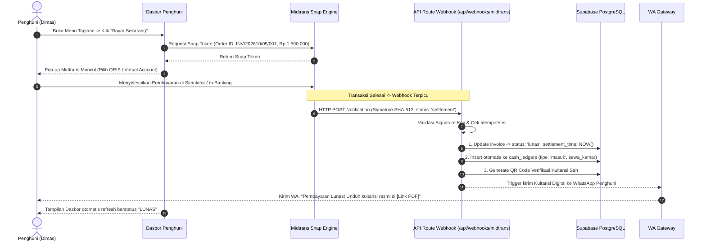

# Product Requirement Document (PRD) — v2.0.0
## Atur Kos: Platform Operasional, Otomasi & SaaS Multi-Tenant Manajemen Kos

**Versi Dokumen:** 2.0.0 (Revisi Komprehensif: Multi-Tenant SaaS, Super Admin, Midtrans Gateway, & 2-Tier Pricing)  
**Status:** Approved / Ready for Implementation  
**Dokumen Referensi Sebelumnya:** `PRD.md` (v1.0.0 - Kos Princess Internal Single-Tenant)  
**Target Rilis:** Q4 2026 (Prototipe & Implementasi Skripsi 8 Minggu)  
**Arsitektur Target:** Next.js (App Router), Supabase (PostgreSQL 15+, Auth, Storage, RLS), Midtrans Snap & Webhook, WhatsApp Gateway (Anti-Ban Jitter), FCM, Flutter (Mobile Geolocation/PWA).

---

## 1. Executive Summary & Problem Statement

### 1.1 Latar Belakang & Masalah Bisnis
Pengelolaan hunian sewa (kos) mandiri di Indonesia umumnya menghadapi tiga kendala operasional yang kronis:
1. **Inefisiensi Pembayaran & Kerja Dua Kali (*Payment Friction*):** Mekanisme transfer bank manual mewajibkan penghuni mengunggah tangkapan layar struk transfer dan pemilik kos harus memeriksa mutasi rekening bank secara manual satu per satu. Hal ini rentan pemalsuan bukti transfer, keterlambatan verifikasi, dan memicu *Days Sales Outstanding* (DSO) tinggi.
2. **Kekosongan Kamar (*Vacancy Lag*) & Ketiadaan Materi Pemasaran:** Pemberitahuan keluar mendadak membuat kamar menganggur rata-rata 15–30 hari sebelum terisi kembali. Pemilik kos kesulitan membuat materi promosi visual yang cepat dan menarik.
3. **Komplain & Layanan Tercecer:** Keluhan kerusakan fasilitas tercampur di obrolan WhatsApp pribadi tanpa pelacakan status, memicu ketidaknyamanan penghuni.

### 1.2 Transformasi Menjadi Platform SaaS Multi-Tenant
Versi awal aplikasi dirancang khusus untuk entitas tunggal (*Kos Princess*). Pada versi 2.0.0 ini, sistem bertransformasi menjadi **Platform SaaS Multi-Tenant ("Atur Kos")** yang dapat digunakan oleh pemilik kos di seluruh Indonesia secara aman dan terisolasi.

Untuk mendukung model SaaS komersial dan kelayakan akademis skripsi, sistem menambahkan 4 pilar arsitektur baru:
1. **Peran Platform Admin (*Super Admin*) & Verifikasi Fisik Kos:** Mencegah kos fiktif/penipuan dengan verifikasi identitas (KTP), foto fisik bangunan, dan titik koordinat GPS (*Dual-Mode Location Picker*).
2. **Otomasi Pembayaran Penuh (*Payment Gateway Midtrans*):** Menghilangkan verifikasi manual melalui pembayaran instan (QRIS & Virtual Account). Status invoice lunas otomatis secara *real-time* via *Webhook Asynchronous*, diikuti penerbitan **Kuitansi Digital Sah dengan QR Code Anti-Manipulasi**.
3. **Model Bisnis Freemium 2 Paket (*2-Tier Pricing*):** Menyediakan Paket Starter (Gratis 1–5 kamar) sebagai pintu masuk adopsi mudah, dan Paket Juragan (Rp 50.000/bln atau Rp 500.000/thn untuk s/d 25 kamar) untuk fitur otomasi penuh.
4. **Protokol WhatsApp Gateway Anti-Banned:** Menerapkan jeda acak (*random jitter delay 5–10 detik*), konten pesan dinamis unik, dan idempotensi ketat guna mencegah pemblokiran nomor oleh Meta.

---

## 2. Product Vision, Objectives & Success Metrics

### 2.1 Visi Produk
Menjadi platform SaaS manajemen hunian sewa mandiri terdepan di Indonesia yang menghilangkan friksi penagihan melalui pembayaran digital otomatis, meminimalkan kamar kosong lewat otomasi cerdas, dan memberikan transparansi hunian yang terpercaya.

### 2.2 Target Metrik Keberhasilan (KPIs)

| Kategori | Metrik Kunci (KPI) | Target Kinerja |
| :--- | :--- | :--- |
| **Operasional Penagihan** | Verifikasi Pembayaran Manual | **0 menit** (100% otomatis via Midtrans Webhook) |
| **Keuangan** | On-Time Rent Payment Rate | $\ge 85\%$ tepat waktu sebelum tanggal jatuh tempo |
| **Keuangan** | Days Sales Outstanding (DSO) | $\le 2$ hari setelah tanggal jatuh tempo |
| **Pemasaran** | Waktu Pembuatan Poster Kamar | $< 10$ detik sekali klik via AI/Canvas Engine |
| **Keandalan Gateway** | Tingkat Keberhasilan WhatsApp Reminder | $\ge 98\%$ terkirim tanpa penalti pemblokiran nomor (Zero Ban) |
| **Adopsi Bisnis** | Rasio Konversi Free ke Paid (Upgrade) | $\ge 25\%$ pemilik kos aktif beralih ke Paket Juragan |

---

## 3. Model Bisnis & Struktur Paket Langganan (*Pricing Plans*)

Sistem menerapkan model **2-Tier Freemium** yang dirancang berdasarkan psikologi pemilik kos di Indonesia (*Product-Led Growth*):

```text
┌───────────────────────────────────────┬───────────────────────────────────────┐
│             PAKET STARTER             │             PAKET JURAGAN             │
│            (Paket Gratis)             │            (Paket Lengkap)            │
├───────────────────────────────────────┼───────────────────────────────────────┤
│           GRATIS SELAMANYA            │           ⭐ ALL-IN-ONE PRO           │
│                                       │                                       │
│             Rp 0 / Bulan              │       • Bulanan: Rp 50.000 / bln      │
│                                       │       • Tahunan: Rp 500.000 / thn     │
│                                       │         🎉 (HEMAT 2 BULAN / Rp 100rb) │
├───────────────────────────────────────┼───────────────────────────────────────┤
│ • Kuota: Maksimal 1 s/d 5 Kamar       │ • Kuota: s/d 25 Kamar                 │
│ • Smart Billing Midtrans (QRIS/VA)    │ • Semua Fitur Starter (Termasuk)      │
│ • Kuitansi Sah Digital (QR Code)      │ • WhatsApp Reminder Otomatis (Cron)   │
│ • Helpdesk Tiket Kerusakan Fasilitas  │ • AI Marketing Poster Generator       │
│ • Pembukuan Kas Masuk & Keluar Dasar  │ • Mitigasi Kamar Kosong H-30          │
│                                       │ • Papan Pengumuman & Paket Kurir (FCM)│
│                                       │ • Ekspor Laporan Keuangan (Excel/PDF) │
├───────────────────────────────────────┼───────────────────────────────────────┤
│ ❌ WA Reminder Otomatis Nonaktif      │ 🚀 Seluruh Otomasi Berjalan Mandiri   │
│ ❌ Poster AI & Pengumuman Terkunci    │    (Pemilik Tinggal Pantau dari HP)   │
└───────────────────────────────────────┴───────────────────────────────────────┘
```

### Aturan Bisnis Paket Langganan:
1. **Kuota Kamar:** Pemilik kos dengan Paket Starter yang mencoba membuat kamar ke-6 otomatis diblokir sistem dan diarahkan ke modal pembayaran Paket Juragan via Midtrans Snap.
2. **Fleksibilitas Fitur:** Pemilik kos dengan $\le 5$ kamar tetap dapat berlangganan Paket Juragan jika ingin menikmati WhatsApp Reminder otomatis dan AI Poster.
3. **Psikologi Diskon Tahunan:** Paket tahunan dibanderol **Rp 500.000 / tahun** (bayar 10 bulan, dapat 12 bulan) guna mengunci retensi pengguna selama 1 tahun penuh (*zero churn*) dan memberikan arus kas di muka bagi platform.

---

## 4. User Personas & Hak Akses (3 Tingkatan Peran)

Sistem membagi pengguna ke dalam 3 tingkatan peran (*Role-Based Access Control*):

```sql
CREATE TYPE user_role AS ENUM ('super_admin', 'owner', 'tenant');
```

### 4.1 Persona 1: Super Admin (Platform Administrator / Tim Pengembang)
* **Karakteristik:** Pengelola platform Atur Kos.
* **Tanggung Jawab:**
  * Memvalidasi keabsahan fisik kos baru (verifikasi KTP, titik koordinat peta, dan foto fisik bangunan).
  * Menyetujui (*approve*), menolak (*reject*), atau membekukan (*suspend*) akun kos yang bermasalah.
  * Memantau transaksi Midtrans dan memonitor kesehatan pengiriman WhatsApp Gateway.

### 4.2 Persona 2: Ibu Rina (Pemilik / Pengelola Kos - *Owner*)
* **Karakteristik:** Wanita, 48 tahun, mengelola 20 kamar kos, aktif menggunakan smartphone, menghindari pembukuan manual yang rumit.
* **Tujuan Utama:**
  * Uang sewa masuk tepat waktu dan otomatis lunas tanpa perlu memeriksa mutasi bank manual.
  * Kamar yang akan kosong segera terisi kembali dengan bantuan poster promosi instan.
  * Penagihan berjalan profesional via WhatsApp tanpa rasa canggung personal.

### 4.3 Persona 3: Dimas (Penghuni Kos - *Tenant*)
* **Karakteristik:** Mahasiswa/Karyawan, 22 tahun, serba digital, jadwal padat.
* **Tujuan Utama:**
  * Membayar uang kos secara instan via QRIS/BCA Virtual Account dari m-banking.
  * Memperoleh kuitansi digital resmi ber-QR Code untuk laporan ke orang tua / kantor.
  * Melaporkan kerusakan fasilitas kamar dengan mudah dan menerima notifikasi saat paket kurir tiba.

---

## 5. User Flows & System Sequence Diagram

### 5.1 Alur Registrasi Properti Kos & Verifikasi Super Admin


### 5.2 Alur Pembayaran Midtrans, Webhook, & Kuitansi Digital Otomatis


---

## 6. Spesifikasi Fungsional Rinci per Modul

### 6.1 Modul 1: Autentikasi, Hak Akses & Multi-Tenancy
* **Registrasi & Login:**
  * Calon penghuni mendaftar dengan Nama Lengkap, Nomor WhatsApp aktif (format internasional `628xxx`), Email, dan Password (min. 8 karakter).
  * Pemilik mendaftar melalui jalur registrasi pemilik kos.
* **Isolasi Data Multi-Tenant:**
  * Setiap data relasional (`rooms`, `tenants`, `invoices`, `complaints`, `cash_ledgers`, `announcements`) terikat secara mutlak pada `kost_id`.
  * Kebijakan PostgreSQL Row-Level Security (RLS) menjamin pengguna dari Kos A tidak dapat membaca atau memodifikasi data Kos B.
* **Proteksi Rute Aplikasi:**
  * `/admin/super` : Khusus role `super_admin`.
  * `/dashboard/owner` : Khusus role `owner` dengan kos terverifikasi aktif.
  * `/dashboard/tenant` : Khusus role `tenant` (menampilkan status menunggu jika belum dialokasikan kamar).

---

### 6.2 Modul 2: Onboarding Properti Kos & Geolocation (Dual-Mode)
* **Formulir Pengajuan Properti:**
  * Input identitas: Nama Kos, Alamat Lengkap, Nomor Kontak Darurat, Nama Bank & Nomor Rekening Pemilik.
  * Upload dokumen: Foto KTP Pemilik dan Foto Fisik Bangunan Tampak Depan / Plang Nama Kos.
* **Dual-Mode Location Picker (Geolokasi Titik Kos):**
  * **Opsi A ("Gunakan Lokasi Saya Saat Ini"):** Menggunakan GPS perangkat (Flutter `geolocator` / Browser Geolocation API) dengan satu klik. Dilengkapi fitur *Reverse Geocoding* otomatis untuk mengisi kolom jalan, kelurahan, dan kota. Tersedia tombol *Geser Pin* untuk fine-tuning akurasi.
  * **Opsi B ("Cari Manual di Peta"):** Modal peta interaktif (Leaflet / OpenStreetMap / Google Maps) dengan bilah pencarian alamat/patokan dan kemampuan *drag-and-drop pin* tepat di atas atap bangunan kos.
* **Penanganan Kasus Gagal (Edge Cases):**
  * Jika izin GPS ditolak (*Permission Denied*), sistem secara otomatis mengalihkan pengguna ke Opsi B (Cari Manual di Peta) dengan pesan informatif tanpa menyebabkan *crash*.
* **Dasbor Verifikasi Super Admin:**
  * Super Admin dapat melihat pratinjau KTP, foto bangunan, dan tombol *Buka Google Street View / Satelit* untuk memastikan fisik bangunan nyata sebelum mengubah status menjadi `active`.

---

### 6.3 Modul 3: Manajemen Kamar, Kuota Paket & Penghuni (Termasuk KYC Identitas)
* **Master Inventaris Kamar:**
  * Nomor kamar, tipe kamar, harga bulanan, daftar fasilitas (array), dan foto kamar.
  * Siklus status kamar: `kosong`, `terisi`, `akan_kosong`, `perbaikan`.
* **Validasi Kuota Kamar Berdasarkan Paket:**
  * Jika `subscription_tier == 'starter'` dan jumlah kamar saat ini $\ge 5$, sistem mengunci tombol "Tambah Kamar" dan menampilkan modal ajakan upgrade ke Paket Juragan.
  * Jika `subscription_tier == 'juragan'`, kuota kamar aktif terbuka hingga 25 kamar.
* **Verifikasi Legalitas Identitas Penghuni & Kontak Darurat (KYC Tenant):**
  * **Input Data KTP:** Penghuni wajib mengisi NIK KTP (16 digit) dan mengunggah foto dokumen KTP resmi melalui menu profil dasbor penghuni.
  * **Perlindungan Privasi NIK (*Masked NIK*):** Di layar antarmuka, NIK disensor otomatis (contoh: `3201**********34`) untuk menjaga privasi data pribadi.
  * **Kontak Darurat (Emergency Contact):** Penghuni wajib mencantumkan Nama Wali/Keluarga Terdekat dan Nomor WhatsApp aktif yang dapat dihubungi saat terjadi keadaan darurat (sakit, kecelakaan, atau kendala mendadak).
  * **Inspeksi Identitas oleh Pemilik:** Pemilik kos dapat melihat lencana status KTP (*KTP Verified / No KTP*) dan membuka modal pratinjau foto KTP serta nomor kontak darurat saat proses alokasi kamar sewa.
* **Alokasi Kamar (Check-In & Check-Out):**
  * Relasi 1 kamar ke 1 penyewa aktif.
  * Mencatat tanggal mulai sewa, tanggal siklus jatuh tempo bulanan, dan tanggal berakhir sewa.
  * Pelepasan sewa (*check-out*) otomatis mengembalikan status kamar menjadi `kosong`.

---

### 6.4 Modul 4: Smart Billing, Midtrans Payment Gateway & Kuitansi Sah
* **Penerbitan Invoice Bulanan:**
  * Diterbitkan otomatis pada H-7 sebelum siklus jatuh tempo masing-masing penghuni.
  * Format nomor invoice unik: `INV/YYYYMM/[NOMOR_KAMAR]/[ID]`.
* **Integrasi Midtrans Snap:**
  * Penghuni mengklik tombol "Bayar Sekarang" $\rightarrow$ sistem meminta Snap Token dari Midtrans backend.
  * Mendukung saluran pembayaran: GoPay, QRIS (Semua Bank/E-Wallet), Virtual Account BCA, BNI, Mandiri, Permata, BRI.
  * Masa kedaluwarsa Snap Token diatur selama **24 jam**. Jika kedaluwarsa, invoice kembali berstatus `belum_bayar` dengan tombol *Buat Ulang Kode Pembayaran*.
* **Penanganan Webhook Asinkronus (`/api/webhooks/midtrans`):**
  * **Validasi Signature Key:** Memverifikasi hash $\text{SHA-512}(\text{order\_id} + \text{status\_code} + \text{gross\_amount} + \text{Server\_Key})$. Request palsu ditolak dengan HTTP `403 Forbidden`.
  * **Idempotensi:** Jika webhook duplikat diterima untuk order yang sudah lunas, sistem tidak akan mencatat kas masuk ganda.
  * Mengubah status invoice menjadi `lunas` dan mencatat `settlement_time`.
* **Penerbitan Kuitansi Digital Anti-Manipulasi:**
  * Menghasilkan dokumen PDF kuitansi resmi berstempel "LUNAS".
  * Dilengkapi **QR Code Verifikasi Publik** yang mengarah ke tautan:  
    `https://aturkos.com/verify-invoice/[NOMOR_INVOICE]`  
    Halaman verifikasi menampilkan keaslian transaksi, nama penyewa, tanggal lunas, dan nominal resmi guna mencegah pemalsuan kuitansi oleh anak kos kepada orang tua.
  * WhatsApp Gateway otomatis mengirimkan tautan unduh kuitansi ke nomor penghuni seketika setelah pembayaran sukses.

---

### 6.5 Modul 5: WhatsApp Notification & Reminder Engine (Protokol Anti-Banned)
* **Ketersediaan Fitur:** Eksklusif untuk kos dengan **Paket Juragan**. (Paket Starter menggunakan fitur bagikan tautan tagihan secara manual).
* **Jadwal Pengingat Berjenjang (Cron Job Harian 09:00 WIB):**
  * **Trigger H-3:** Jatuh tempo dalam 3 hari $\rightarrow$ Notifikasi tagihan terbit beserta rincian sewa.
  * **Trigger Hari H:** Jatuh tempo hari ini $\rightarrow$ Pengingat batas akhir pembayaran.
  * **Trigger H+2:** Jatuh tempo terlewat 2 hari $\rightarrow$ Pemberitahuan tunggakan pembayaran.
* **Protokol Keamanan Anti-Banned (Meta Spam Shield):**
  1. **Random Jitter Delay:** Sistem wajib memberi jeda acak **5 sampai 10 detik** antar pengiriman pesan, menyimulasikan ritme pengetikan manusia.
  2. **Konten Dinamis 100% Unik:** Setiap pesan menyertakan variabel unik `{nama_penghuni}`, `{nomor_kamar}`, `{nominal_sewa}`, `{nomor_invoice}`, dan `{waktu_kirim}` agar pesan tidak terbaca sebagai *broadcast spam*.
  3. **Auto-Cancel & Idempotensi:** Jika invoice sudah berstatus `lunas`, pengiriman reminder otomatis dibatalkan (*skip*). Maksimal 1 pengingat per penghuni per hari dicatat pada tabel `notification_logs`.
  4. **Pesan Penutup Bersahabat:** Menyertakan kontak pemilik untuk menghindari penghuni menekan tombol *Report as Spam*.

---

### 6.6 Modul 6: Helpdesk Kerusakan Fasilitas
* **Cakupan Laporan:**
  * `kamar_pribadi` : Hanya terlihat oleh pelapor dan pemilik kos.
  * `fasilitas_umum` : Terlihat oleh seluruh penghuni satu kos (contoh: pompa air mati, lampu lorong putus, kompor umum rusak) untuk mencegah laporan duplikat.
* **Spesifikasi Formulir:**
  * Melampirkan foto bukti kerusakan bersifat **opsional** (penghuni dapat mengambil foto langsung via Kamera, memilih dari Galeri, atau melewati tanpa melampirkan foto untuk situasi darurat). Kompresi otomatis $< 500$ KB.
* **Pelacakan Status:**
  * `diajukan` $\rightarrow$ `sedang_dikerjakan` (disertai jadwal teknisi/tukang) $\rightarrow$ `selesai`.

---

### 6.7 Modul 7: Mitigasi Kamar Kosong H-30 & AI Poster Generator
* **Ketersediaan Fitur:** Eksklusif untuk **Paket Juragan**.
* **Mekanisme Peringatan H-30:**
  * Deteksi otomatis sisa masa sewa 30 hari memicu modal formulir komitmen di dasbor penghuni.
  * Pilihan "Lanjut Sewa" $\rightarrow$ Jadwal sewa periode berikutnya disiapkan.
  * Pilihan "Selesai Sewa" $\rightarrow$ Status kamar otomatis beralih menjadi `akan_kosong` per tanggal check-out.
  * **Fallback H-20 (Anti-Spam):** Jika tidak ada respons hingga H-20, modal popup berhenti dan sistem menandai kamar di dasbor pemilik sebagai `perlu_konfirmasi_manual`.
* **AI / Automated Marketing Poster Generator:**
  * Tombol "Buat Poster Promosi" aktif pada kamar berstatus `akan_kosong` atau `kosong`.
  * Merender grafis siap sebar dalam 2 format: **1:1 (Feed Instagram)** dan **9:16 (WhatsApp & IG Story)** menggunakan Canvas/Satori.
  * Memuat foto utama kamar, harga, ikon fasilitas, tanggal ketersediaan, kontak WhatsApp pemilik, dan QR Code lokasi peta kos.
  * Otomatis menghasilkan teks caption promosi siap salin (*copy-paste*) ke media sosial.

---

### 6.8 Modul 8: Pembukuan Arus Kas Sederhana (*Cash Ledger*)
* **Kas Masuk Otomatis:**
  * Setiap transaksi Midtrans yang berhasil (*settlement*) otomatis dimasukkan ke tabel `cash_ledgers` bertipe `masuk`, kategori `sewa_kamar`, dengan referensi `invoice_id`.
* **Kas Keluar Operasional Manual:**
  * Pemilik mencatat pengeluaran operasional (listrik, air, teknisi perbaikan, sampah, kebersihan) lengkap dengan tanggal, nominal, dan foto nota.
* **Laporan Finansial:**
  * Ringkasan pendapatan kotor, total pengeluaran, dan laba bersih operasional.
  * Pemilik Paket Juragan dapat mengekspor rekap buku kas bulanan/tahunan ke format file Excel (*.xlsx) atau PDF.

---

### 6.9 Modul 9: Papan Pengumuman Digital & Notifikasi Paket Kurir
* **Ketersediaan Fitur:** Eksklusif untuk **Paket Juragan**.
* **Kategori Pengumuman:** `paket`, `barang_hilang` (Lost-and-Found), `info_operasional`, `umum`.
* **Smart Push Notification Targeting (via FCM):**
  * **Target Kamar Spesifik (`target_room_id`):** Digunakan saat paket kurir berlabel nomor kamar tiba di lobi. Push notification ponsel hanya dikirimkan ke penghuni kamar tersebut untuk menghindari *notification fatigue* bagi penghuni lain.
  * **Target Broadcast (`target_room_id IS NULL`):** Untuk barang tercecer atau pemberitahuan darurat air/listrik padam ke seluruh penghuni kos.
* **Penyelesaian Status (`is_resolved`):**
  * Tombol *"Tandai Sudah Diambil"* memindahkan kartu pengumuman paket dari beranda aktif ke riwayat arsip.

---

### 6.10 Modul 10: Manajemen Langganan & Upgrade Paket
* **Status Paket Properti:** Setiap kos menyimpan atribut `subscription_tier`, `max_rooms`, dan `subscription_expires_at`.
* **Alur Upgrade Instan:**
  * Pemilik kos di Paket Starter dapat mengklik "Upgrade ke Paket Juragan" kapan saja.
  * Pemilik memilih siklus: Bulanan (Rp 50.000) atau Tahunan (Rp 500.000).
  * Pembayaran diproses via Midtrans Snap. Webhook pembayaran langganan otomatis memperbarui status kos menjadi `juragan` dan membuka kuota hingga 25 kamar serta seluruh fitur otomasi.

---

## 7. Non-Functional Requirements (NFRs)

### 7.1 Keamanan & Integritas Data
* **PostgreSQL Row-Level Security (RLS):** Wajib diaktifkan di seluruh tabel. Setiap kueri tenant terisolasi oleh `kost_id` dan `user_id`.
* **Signature Verification Midtrans:** Validasi ketat tanda tangan SHA-512 pada endpoint webhook guna menangkal serangan pemalsuan status lunas dari pihak luar.
* **Penyimpanan Berkas Terproteksi:** Dokumen sensitif (KTP pemilik) disimpan dalam *private bucket* Supabase Storage dengan akses khusus Super Admin.

### 7.2 Performa & Skalabilitas
* **Latensi Webhook:** Pemrosesan webhook Midtrans dan mutasi basis data selesai dalam waktu $< 800$ ms.
* **Kompresi Gambar Sisi Klien:** Foto kamar, keluhan, dan nota dikompresi otomatis pada perangkat pengguna (maksimal resolusi 1280px, kualitas 80%, ukuran berkas $< 500$ KB) sebelum diunggah ke storage.

### 7.3 Keandalan & Ketahanan Gateway
* **Algoritma Anti-Ban WA:** Antrean pengiriman pengingat menggunakan antrean berbasis Redis/Database dengan *rate-limiter* terkonfigurasi (jeda 5–10 detik per pesan). Mekanisme *retry* maksimal 2 kali untuk kegagalan koneksi jaringan.

---

## 8. Spesifikasi Skema Basis Data Lengkap (PostgreSQL Supabase)

```sql
-- ==============================================================================
-- ATUR KOS - DATABASE SCHEMA v2.0.0
-- Multi-Tenant SaaS, Super Admin, Midtrans Integration, Geolocation, Subscriptions
-- ==============================================================================

BEGIN;

CREATE EXTENSION IF NOT EXISTS "uuid-ossp";

-- 1. ENUM TYPES
DO $$ BEGIN
    IF NOT EXISTS (SELECT 1 FROM pg_type WHERE typname = 'user_role') THEN
        CREATE TYPE user_role AS ENUM ('super_admin', 'owner', 'tenant');
    END IF;
    IF NOT EXISTS (SELECT 1 FROM pg_type WHERE typname = 'kost_status') THEN
        CREATE TYPE kost_status AS ENUM ('pending_verification', 'active', 'rejected', 'suspended');
    END IF;
    IF NOT EXISTS (SELECT 1 FROM pg_type WHERE typname = 'subscription_tier') THEN
        CREATE TYPE subscription_tier AS ENUM ('starter', 'juragan');
    END IF;
    IF NOT EXISTS (SELECT 1 FROM pg_type WHERE typname = 'room_status') THEN
        CREATE TYPE room_status AS ENUM ('kosong', 'terisi', 'akan_kosong', 'perbaikan');
    END IF;
    IF NOT EXISTS (SELECT 1 FROM pg_type WHERE typname = 'tenant_status') THEN
        CREATE TYPE tenant_status AS ENUM ('aktif', 'akan_berakhir', 'keluar');
    END IF;
    IF NOT EXISTS (SELECT 1 FROM pg_type WHERE typname = 'invoice_status') THEN
        CREATE TYPE invoice_status AS ENUM ('belum_bayar', 'menunggu_verifikasi', 'lunas', 'kedaluwarsa', 'batal');
    END IF;
    IF NOT EXISTS (SELECT 1 FROM pg_type WHERE typname = 'complaint_scope') THEN
        CREATE TYPE complaint_scope AS ENUM ('kamar_pribadi', 'fasilitas_umum');
    END IF;
    IF NOT EXISTS (SELECT 1 FROM pg_type WHERE typname = 'complaint_status') THEN
        CREATE TYPE complaint_status AS ENUM ('diajukan', 'sedang_dikerjakan', 'selesai');
    END IF;
    IF NOT EXISTS (SELECT 1 FROM pg_type WHERE typname = 'cash_flow_type') THEN
        CREATE TYPE cash_flow_type AS ENUM ('masuk', 'keluar');
    END IF;
    IF NOT EXISTS (SELECT 1 FROM pg_type WHERE typname = 'announcement_category') THEN
        CREATE TYPE announcement_category AS ENUM ('paket', 'barang_hilang', 'info_operasional', 'umum');
    END IF;
END $$;

-- 2. TABEL: kosts (Entitas Properti Kos Multi-Tenant)
CREATE TABLE IF NOT EXISTS public.kosts (
    id UUID PRIMARY KEY DEFAULT gen_random_uuid(),
    nama_kost VARCHAR(100) NOT NULL,
    alamat TEXT NOT NULL,
    nomor_kontak VARCHAR(20) NOT NULL,
    rekening_bank VARCHAR(50),
    nama_pemilik_rekening VARCHAR(100),
    -- Data Geolocation Dual-Mode
    latitude NUMERIC(10, 8),
    longitude NUMERIC(11, 8),
    google_maps_url TEXT,
    -- Data Verifikasi Super Admin
    foto_bangunan_url TEXT,
    dokumen_ktp_url TEXT,
    status_verifikasi kost_status NOT NULL DEFAULT 'pending_verification',
    catatan_verifikasi_admin TEXT,
    diverifikasi_pada TIMESTAMPTZ,
    -- Model Langganan 2-Tier
    tier subscription_tier NOT NULL DEFAULT 'starter',
    max_rooms INT NOT NULL DEFAULT 5,
    subscription_expires_at TIMESTAMPTZ,
    created_at TIMESTAMPTZ DEFAULT NOW(),
    updated_at TIMESTAMPTZ DEFAULT NOW()
);
CREATE INDEX IF NOT EXISTS idx_kosts_status ON public.kosts(status_verifikasi);
CREATE INDEX IF NOT EXISTS idx_kosts_lat_long ON public.kosts(latitude, longitude);

-- 3. TABEL: profiles (Sinkronisasi dengan auth.users)
CREATE TABLE IF NOT EXISTS public.profiles (
    id UUID PRIMARY KEY REFERENCES auth.users(id) ON DELETE CASCADE,
    kost_id UUID REFERENCES public.kosts(id) ON DELETE RESTRICT,
    full_name TEXT NOT NULL,
    nomor_wa VARCHAR(20) UNIQUE,
    role user_role NOT NULL DEFAULT 'tenant',
    avatar_url TEXT,
    fcm_token TEXT,
    -- Identitas Legalitas Penghuni & Kontak Darurat (KYC Tenant)
    nik_ktp VARCHAR(20),
    dokumen_ktp_url TEXT,
    kontak_darurat_nama VARCHAR(100),
    kontak_darurat_wa VARCHAR(20),
    status_identitas VARCHAR(30) DEFAULT 'unverified',
    created_at TIMESTAMPTZ DEFAULT NOW(),
    updated_at TIMESTAMPTZ DEFAULT NOW()
);
CREATE INDEX IF NOT EXISTS idx_profiles_kost_id ON public.profiles(kost_id);
CREATE INDEX IF NOT EXISTS idx_profiles_role ON public.profiles(role);

-- 4. TABEL: rooms (Inventaris Kamar)
CREATE TABLE IF NOT EXISTS public.rooms (
    id UUID PRIMARY KEY DEFAULT gen_random_uuid(),
    kost_id UUID NOT NULL REFERENCES public.kosts(id) ON DELETE CASCADE,
    nomor_kamar VARCHAR(20) NOT NULL,
    tipe VARCHAR(50) NOT NULL DEFAULT 'Standard',
    harga_bulanan NUMERIC(12, 2) NOT NULL,
    fasilitas TEXT[] DEFAULT '{}',
    foto_url TEXT,
    status room_status NOT NULL DEFAULT 'kosong',
    created_at TIMESTAMPTZ DEFAULT NOW(),
    updated_at TIMESTAMPTZ DEFAULT NOW(),
    CONSTRAINT unique_room_per_kost UNIQUE (kost_id, nomor_kamar)
);
CREATE INDEX IF NOT EXISTS idx_rooms_kost_status ON public.rooms(kost_id, status);

-- 5. TABEL: tenants (Alokasi Sewa Aktif Penghuni & Kamar)
CREATE TABLE IF NOT EXISTS public.tenants (
    id UUID PRIMARY KEY DEFAULT gen_random_uuid(),
    kost_id UUID NOT NULL REFERENCES public.kosts(id) ON DELETE CASCADE,
    user_id UUID NOT NULL REFERENCES public.profiles(id) ON DELETE CASCADE,
    room_id UUID NOT NULL REFERENCES public.rooms(id) ON DELETE RESTRICT,
    tanggal_masuk DATE NOT NULL,
    tanggal_jatuh_tempo_bulanan INT NOT NULL CHECK (tanggal_jatuh_tempo_bulanan BETWEEN 1 AND 31),
    tanggal_akhir_sewa DATE,
    status_sewa tenant_status NOT NULL DEFAULT 'aktif',
    h30_response VARCHAR(30) DEFAULT 'menunggu', -- 'lanjut', 'selesai', 'menunggu', 'perlu_manual'
    created_at TIMESTAMPTZ DEFAULT NOW(),
    updated_at TIMESTAMPTZ DEFAULT NOW()
);
CREATE INDEX IF NOT EXISTS idx_tenants_active ON public.tenants(kost_id, status_sewa);
CREATE INDEX IF NOT EXISTS idx_tenants_user ON public.tenants(user_id);

-- 6. TABEL: invoices (Siklus Tagihan & Integrasi Midtrans)
CREATE TABLE IF NOT EXISTS public.invoices (
    id UUID PRIMARY KEY DEFAULT gen_random_uuid(),
    kost_id UUID NOT NULL REFERENCES public.kosts(id) ON DELETE CASCADE,
    tenant_id UUID NOT NULL REFERENCES public.tenants(id) ON DELETE RESTRICT,
    order_id VARCHAR(60) NOT NULL UNIQUE, -- INV/YYYYMM/KAMAR/ID
    periode VARCHAR(20) NOT NULL, -- 'YYYY-MM'
    nominal NUMERIC(12, 2) NOT NULL,
    tanggal_jatuh_tempo DATE NOT NULL,
    -- Midtrans Integrasi
    snap_token TEXT,
    payment_type VARCHAR(50), -- 'qris', 'bank_transfer', 'gopay'
    midtrans_transaction_id TEXT,
    transaction_time TIMESTAMPTZ,
    settlement_time TIMESTAMPTZ,
    status invoice_status NOT NULL DEFAULT 'belum_bayar',
    -- Kuitansi Sah Digital
    qr_verification_code TEXT UNIQUE,
    kuitansi_pdf_url TEXT,
    created_at TIMESTAMPTZ DEFAULT NOW(),
    updated_at TIMESTAMPTZ DEFAULT NOW()
);
CREATE INDEX IF NOT EXISTS idx_invoices_status_date ON public.invoices(kost_id, status, tanggal_jatuh_tempo);
CREATE INDEX IF NOT EXISTS idx_invoices_order_id ON public.invoices(order_id);

-- 7. TABEL: notification_logs (Log Anti-Banned WhatsApp Reminder)
CREATE TABLE IF NOT EXISTS public.notification_logs (
    id UUID PRIMARY KEY DEFAULT gen_random_uuid(),
    invoice_id UUID NOT NULL REFERENCES public.invoices(id) ON DELETE CASCADE,
    tipe_reminder VARCHAR(20) NOT NULL, -- 'H-3', 'Hari-H', 'H+2', 'Kuitansi'
    nomor_tujuan VARCHAR(20) NOT NULL,
    status_kirim VARCHAR(20) NOT NULL, -- 'sent', 'failed'
    response_payload JSONB,
    sent_at TIMESTAMPTZ DEFAULT NOW()
);
CREATE UNIQUE INDEX IF NOT EXISTS uq_invoice_reminder ON public.notification_logs(invoice_id, tipe_reminder);

-- 8. TABEL: complaints (Tiket Keluhan Kerusakan)
CREATE TABLE IF NOT EXISTS public.complaints (
    id UUID PRIMARY KEY DEFAULT gen_random_uuid(),
    kost_id UUID NOT NULL REFERENCES public.kosts(id) ON DELETE CASCADE,
    tenant_id UUID NOT NULL REFERENCES public.tenants(id) ON DELETE CASCADE,
    tipe_fasilitas complaint_scope NOT NULL DEFAULT 'kamar_pribadi',
    judul VARCHAR(150) NOT NULL,
    deskripsi TEXT NOT NULL,
    foto_urls TEXT[] DEFAULT '{}',
    status complaint_status NOT NULL DEFAULT 'diajukan',
    catatan_penanganan TEXT,
    diselesaikan_pada TIMESTAMPTZ,
    created_at TIMESTAMPTZ DEFAULT NOW(),
    updated_at TIMESTAMPTZ DEFAULT NOW()
);
CREATE INDEX IF NOT EXISTS idx_complaints_kost_status ON public.complaints(kost_id, status);

-- 9. TABEL: cash_ledgers (Buku Kas Masuk Otomatis & Kas Keluar)
CREATE TABLE IF NOT EXISTS public.cash_ledgers (
    id UUID PRIMARY KEY DEFAULT gen_random_uuid(),
    kost_id UUID NOT NULL REFERENCES public.kosts(id) ON DELETE CASCADE,
    tipe cash_flow_type NOT NULL,
    kategori VARCHAR(50) NOT NULL, -- 'sewa_kamar', 'listrik_air', 'wifi', 'perbaikan', 'lainnya'
    nominal NUMERIC(12, 2) NOT NULL,
    tanggal DATE NOT NULL DEFAULT CURRENT_DATE,
    keterangan TEXT,
    invoice_id UUID REFERENCES public.invoices(id) ON DELETE SET NULL,
    bukti_nota_url TEXT,
    created_at TIMESTAMPTZ DEFAULT NOW()
);
CREATE INDEX IF NOT EXISTS idx_cash_ledgers_date ON public.cash_ledgers(kost_id, tanggal);

-- 10. TABEL: announcements (Papan Pengumuman & Paket Kurir FCM)
CREATE TABLE IF NOT EXISTS public.announcements (
    id UUID PRIMARY KEY DEFAULT gen_random_uuid(),
    kost_id UUID NOT NULL REFERENCES public.kosts(id) ON DELETE CASCADE,
    author_id UUID NOT NULL REFERENCES public.profiles(id) ON DELETE CASCADE,
    target_room_id UUID REFERENCES public.rooms(id) ON DELETE SET NULL, -- NULL jika broadcast umum
    kategori announcement_category NOT NULL DEFAULT 'paket',
    judul VARCHAR(150) NOT NULL,
    deskripsi TEXT NOT NULL,
    foto_urls TEXT[] DEFAULT '{}',
    is_pinned BOOLEAN DEFAULT FALSE,
    is_resolved BOOLEAN DEFAULT FALSE,
    created_at TIMESTAMPTZ DEFAULT NOW(),
    updated_at TIMESTAMPTZ DEFAULT NOW()
);
CREATE INDEX IF NOT EXISTS idx_announcements_kost ON public.announcements(kost_id, is_pinned DESC, created_at DESC);
CREATE INDEX IF NOT EXISTS idx_announcements_target_room ON public.announcements(target_room_id);

COMMIT;
```

---

## 9. Integrasi Pihak Ketiga (*Third-Party Services*)

| Layanan | Provider / Pustaka | Fungsi dalam Sistem |
| :--- | :--- | :--- |
| **Payment Gateway** | Midtrans Snap & Webhook (Sandbox) | Penyedia QRIS & Virtual Account serta pemicu webhook otomatis |
| **Database & Auth** | Supabase (PostgreSQL 15+, Auth, Storage) | Manajemen pengguna JWT, RLS Multi-Tenant, penyimpanan dokumen KTP privat |
| **Notifikasi WhatsApp** | Fonnte / Wablas REST API | Pengiriman notifikasi pengingat terjadwal dengan jeda anti-banned |
| **Push Notification** | Firebase Cloud Messaging (FCM) | Notifikasi instan ponsel untuk paket kurir tiba terarah ke nomor kamar |
| **Peta & Lokasi (Flutter/Web)** | `geolocator`, `geocoding`, `flutter_map` / Leaflet | Deteksi GPS 1-klik, reverse geocoding alamat, dan peta interaktif pin lokasi |
| **Poster Promosi Engine** | `@vercel/og` / Satori / Canvas API | Merender grafik poster kamar kosong rasio 1:1 dan 9:16 secara instan |
| **Penjadwal Cron** | Vercel Cron / Supabase pg_cron | Pemicu cron harian pukul 09:00 WIB untuk pemindaian jatuh tempo |

---

## 10. Manajemen Risiko & Mitigasi (*Risks & Mitigations*)

| Risiko Teridentifikasi | Tingkat Risiko | Rencana Mitigasi Sistem |
| :--- | :---: | :--- |
| **Pemblokiran Nomor WhatsApp oleh Meta** | Tinggi | Terapkan jeda acak 5–10 detik (*random jitter*), batasi 1 pesan/hari, gunakan konten dinamis unik, dan otomatis batalkan reminder jika invoice sudah berstatus lunas. |
| **Pendaftaran Properti Kos Fiktif / Penipuan** | Tinggi | Wajibkan verifikasi identitas KTP dan foto fisik tampak depan oleh Super Admin sebelum kos dapat menerbitkan tagihan atau mengundang penyewa. |
| **Kegagalan / Duplikasi Webhook Midtrans** | Sedang | Terapkan validasi tanda tangan SHA-512 Server Key dan skema idempotensi pada basis data untuk mencegah pencatatan kas masuk ganda. |
| **Penolakan Izin Lokasi GPS oleh Pemilik** | Rendah | Sediakan opsi *Cari Manual di Peta* dengan bilah pencarian alamat/patokan sebagai mekanisme cadangan (*fallback*). |
| **Pemalsuan Dokumen Kuitansi oleh Penghuni** | Sedang | Sematkan QR Code dinamis pada kuitansi yang mengarah ke tautan verifikasi publik resmi berstempel digital sistem. |

---

## 11. Rencana Pelaksanaan & Roadmap (Sprint 8 Minggu)

* **Minggu 1–2: Sprint 1 (Fondasi Multi-Tenant, Super Admin & Geolokasi)**
  * Migrasi basis data v2.0.0 & konfigurasi Supabase RLS.
  * Form pendaftaran kos dengan Dual-Mode Geolocation (GPS + Peta).
  * Dasbor verifikasi Super Admin (Approve/Reject properti).
* **Minggu 3–4: Sprint 2 (Integrasi Midtrans Snap, Webhook & Kuitansi Digital)**
  * Penerbitan invoice bulanan otomatis.
  * Integrasi Midtrans Snap (Sandbox QRIS & Virtual Account).
  * Webhook handler Next.js dengan validasi SHA-512 & pencatatan kas masuk otomatis.
  * Generator Kuitansi PDF ber-QR Code anti-manipulasi.
* **Minggu 5: Sprint 3 (WhatsApp Reminder Anti-Ban & Langganan 2-Tier)**
  * Logika pembatasan paket: Starter (Maks 5 kamar) vs Juragan (s/d 25 kamar).
  * Mesin Cron WhatsApp pengingat terjadwal dengan jeda acak 5–10 detik.
* **Minggu 6: Sprint 4 (Helpdesk Kerusakan & Papan Pengumuman Paket FCM)**
  * Tiket keluhan fasilitas kamar & umum dengan multi-foto.
  * Modul pengumuman paket kurir tiba terarah ke kamar spesifik via FCM.
* **Minggu 7: Sprint 5 (Mitigasi H-30 & AI Marketing Poster Generator)**
  * Logika deteksi sisa masa sewa 30 hari & fallback H-20.
  * Generator poster promosi kamar kosong rasio 1:1 dan 9:16 siap sebar.
* **Minggu 8: Sprint 6 (UAT, Audit Keamanan, & Finalisasi Skripsi)**
  * UAT bersama pemilik kos dan perwakilan mahasiswa penghuni.
  * Pengujian end-to-end skenario pembayaran sandbox Midtrans dan keandalan webhook.
  * Penyusunan laporan pengujian dan dokumentasi akhir.
